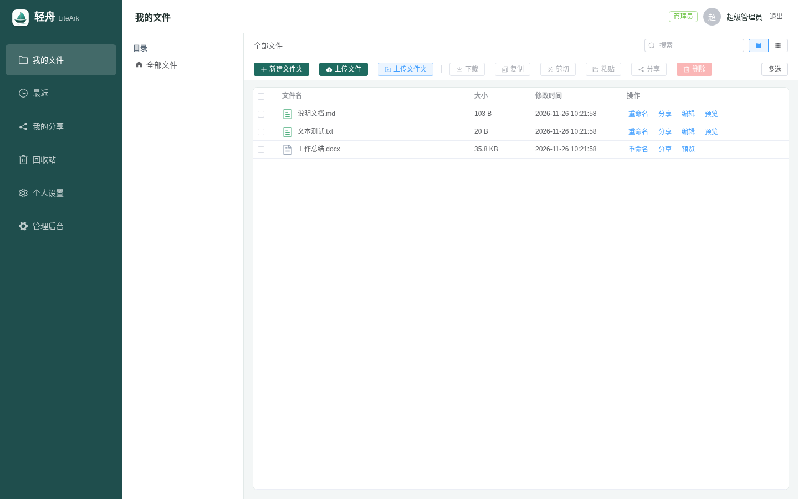

<p align="center"></p>

<h1 align="center">轻舟 LiteArk · 私有网盘</h1>

<p align="center">
轻量 · 私有 · 可靠的自托管文件网盘<br/>
单 fat jar 交付，内网离线可部署，PC 与手机同一套界面
</p>

<p align="center">
  
  
  
  
  
</p>



轻舟是一套可完全内网离线部署的私有网盘，采用 **单 fat jar** 交付：前端构建产物内嵌在 jar 中，内网服务器只需预装 JDK 1.8，无需 Maven、无需拉取任何依赖、无需单独部署前端或 Nginx。

- 技术基线：SpringBoot 2.7.18 + Java 8 + MyBatis-Plus 3.5.5 + SQLite（sqlite-jdbc）+ Vue3 + Element Plus
- 交付形态：`target/liteark.jar`（约 60MB，含前端 dist 与全部依赖）+ 一个外置配置目录
- 访问入口：前台网盘 `/`、管理后台 `/admin/overview`、免登录共享页 `/s/{token}`

## 一、快速启动

### 1. 本地/外网开发
```bash
# 前端开发（前端 5173，代理后端 8080）
cd web && npm install && npm run dev

# 后端开发
export JAVA_HOME=<JDK8路径>
mvn spring-boot:run

# 一键构建 fat jar（先构建前端再打 jar）
cd web && npm run build && cd ..
rm -rf src/main/resources/static/* && cp -r web/dist/* src/main/resources/static/
mvn clean package -DskipTests
# 产物：target/liteark.jar
```

### 2. 内网生产部署（干净机器）
```bash
# 前提：仅预装 OpenJDK 1.8（java -version 显示 1.8.x）
mkdir -p /opt/liteark/{conf,data,logs}
cp liteark.jar /opt/liteark/
cp application.yml /opt/liteark/conf/     # 来自 deploy/conf/application.yml

# 启动（外置配置优先于 jar 内置配置）
java -jar /opt/liteark/liteark.jar \
  --spring.config.location=/opt/liteark/conf/application.yml
```

首次启动自动完成：创建数据目录、建表、初始化角色与账号。浏览器访问 `http://服务器IP:8080`。

### 2.1 部署到子路径（如 `https://example.com/liteark/`）

前端资源与接口路径全部跟随 vite `base`，构建时指定即可，无需改代码：

```bash
cd web
VITE_BASE=/liteark/ npm run build      # 不带该变量则默认部署在根路径 `/`
cd ..
rm -rf src/main/resources/static/* && cp -r web/dist/* src/main/resources/static/
mvn clean package -DskipTests
```

反向代理把 `/liteark/` 转发到本服务（服务本身仍监听根路径，由代理去掉前缀）：

```nginx
location /liteark/ {
    proxy_pass http://127.0.0.1:8080/;
    proxy_set_header Host $host;
    proxy_set_header X-Real-IP $remote_addr;
    proxy_set_header X-Forwarded-For $proxy_add_x_forwarded_for;
    client_max_body_size 2048m;
    proxy_request_buffering off;      # 大文件上传流式转发
    proxy_read_timeout 600s;
    proxy_send_timeout 600s;
}
```

> 注意：`proxy_pass` 末尾的 `/` 不能省，否则前缀不会被剥离。

### 3. 初始账号

| 账号 | 密码 | 角色 |
|------|------|------|
| admin | admin123 | 超级管理员 |
| demo  | 123456   | 普通用户 |

**部署后第一步：修改 admin 密码，并把外置配置中的 `liteark.jwt-secret` 改为长随机字符串。**

## 二、配置

配置分三层，优先级从高到低：

1. 命令行参数：`java -jar liteark.jar --server.port=9090 --liteark.jwt-secret=xxx`
2. 外置配置：`--spring.config.location=/opt/liteark/conf/application.yml`
3. jar 内置配置：`src/main/resources/application.yml`

关键配置项：

| 配置项 | 默认值 | 说明 |
|--------|--------|------|
| `server.port` | 8080 | 服务端口（环境变量 `LITEARK_PORT`） |
| `liteark.data-dir` | ./data | 数据根目录，数据库与文件实体都在此下 |
| `liteark.files-dir` | {data-dir}/files | 文件实体目录 |
| `liteark.temp-dir` | {data-dir}/temp | 临时目录 |
| `liteark.jwt-secret` | 开发默认值 | **生产必须替换为长随机串** |
| `liteark.default-quota` | 21474836480 | 新用户默认配额（20GB） |
| `liteark.max-file-size` | 2147483648 | 单文件上限（2GB） |
| `liteark.conflict-strategy` | rename | 同名冲突策略：rename / skip / overwrite |
| `liteark.admin-ip-whitelist-enabled` | false | 后台 IP 白名单开关 |

> 注意：数据库路径由 `liteark.data-dir` 统一决定（数据源 URL 引用它），改 data-dir 即可整体迁移数据目录。目录不存在时应用会在启动前自动创建。

完整配置说明见 `docs/配置说明.md`。

## 三、功能概览

**前台网盘**：登录/注册、目录树、文件/文件夹增删改查、复制/剪切/粘贴（含文件夹递归）、回收站与还原、小文件直传与**大文件分片断点续传**（暂停/继续/取消、刷新续传、不重传已完成分片）、移动端拍照/相册上传、单文件与批量 ZIP 下载、列表/网格视图、搜索、文本在线编辑（30s 自动保存、历史版本与回滚）、图片缩略图（png/jpg/gif/webp/bmp/svg）/ PDF / 音视频（支持拖动进度）/ Markdown / CSV / Office 只读预览、中文与特殊字符文件名全程无乱码、共享链接（权限/密码/有效期/下载次数/访问记录）、**文件夹自助授权**（把自己的文件夹按查看/编辑/下载/上传授权给同事，递归生效，「我的分享」集中管理并可随时撤销）。

**管理后台**：系统概览、用户管理、角色管理（每个角色可维护**默认文件夹权限**，角色下用户自动继承）、**文件夹级细化权限**（查看/编辑/下载/上传四项，授权对象默认角色，也可对具体用户「直接指定」或「按角色授权」，递归生效、上级包含下级、支持阻断继承）、共享管控、操作日志（分页筛选 + CSV 导出）、系统配置。

**运维**：回收站/分片/过期共享/日志自动清理、后台 IP 白名单、可选接口文档（默认关闭）。

**三端响应式**：桌面（侧栏+列表）、平板（抽屉菜单）、移动（单列+底部 Tab+悬浮上传按钮），断点 320–1920px。

详细功能清单见 `docs/功能说明.md`；分册文档：`docs/网盘功能说明.md`（文件、上传下载、预览、共享）、`docs/权限说明.md`（权限模型、角色默认权限、按角色授权）。需求原文见 `LiteArk需求-V1.1.md`。

## 四、数据目录结构

```
/opt/liteark/
├── liteark.jar              # 单包交付
├── conf/application.yml     # 外置配置
├── data/
│   ├── liteark.db           # SQLite 数据库（含 WAL）
│   ├── files/{用户ID}/      # 文件实体，按用户隔离
│   └── temp/                # 临时文件
└── logs/liteark.log         # 运行日志
```

备份只需打包 `data/` 目录；迁移只需拷贝 jar + conf + data 到新机器。

## 五、安全建议

- 生产环境务必修改 `liteark.jwt-secret` 与初始账号密码
- 后台 `/admin/**` 可在 Nginx 层追加 IP 白名单，或设置 `liteark.admin-ip-whitelist-enabled=true`（已生效，拦截 `/admin/**` 与 `/api/admin/**`）
- 文件实体按用户 ID 隔离存储，接口层统一做文件夹权限校验：所有者与被授权者按各自有效权限访问，未被授权的他人目录一律 403 / 列表不可见
- OpenAPI/swagger-ui 默认关闭，内网如需开启设置 `LITEARK_API_DOCS=true`
- Office 只读预览双通道：装有 LibreOffice（含 headless）时转 PDF 高保真预览；未装时 docx/xlsx/pptx 自动用 Apache POI 渲染只读 HTML（文字/表格可读，版式简化），旧版 doc/xls/ppt 仍需 LibreOffice。PDF 由浏览器内置阅读器内联显示
- 预览接口支持 HTTP Range，音视频/大 PDF 可拖动进度；HTML/SVG 内联预览带 CSP sandbox，脚本不会执行

## 六、本版本边界

V1.1 曾列出的 10 项未实现能力已补齐 9 项（分片续传、Office 转码只读预览、细粒度 RBAC、版本回滚、自动清理、移动端编辑、共享下载限制、日志导出、IP 白名单/接口文档）。剩余边界：OnlyOffice 在线编辑（需求 Q-11 待定，本期不引入）、文本存储备选模式、amd64/arm64 实机验证记录。详见 `docs/功能说明.md` 的"需求全量对齐与剩余边界"。

## 七、许可证

[MIT](LICENSE) © 2026 BKChuTang
